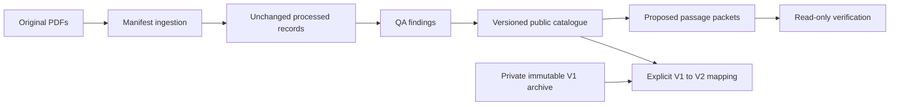

# Better Call AI architecture

The application currently provides a FastAPI health service and a React/TypeScript
workspace. Question submission and voice calls remain unavailable. No retrieval
engine, model integration or legal-answer endpoint exists.

Local ingestion accepts explicit manifests and text PDFs/TXT. Raw byte hashes,
document identity, physical pages, Unicode text and uncertainty are preserved.
Source provenance is user-supplied; extraction is not proof of authenticity,
current law, visual correctness or case applicability.

Stage 2E performs extraction consistency/quality checks. Stage 2F binds narrow
passages to exact source, processed-record, QA, catalogue, page and line hashes.
Its original implementation remains unchanged. Stage 2G discovers only complete
QA-located English notification paragraphs and reuses the Stage 2F exclusion
policy. Discovery never creates a review event.

Publication V2 adds a separate configuration and ledger namespace using the same
canonicalization, candidate model, identity algorithm and exclusion functions.
V2's verification CLI is read-only. It exposes no submission or approval action.
The original V1 manual-review CLI remains available for synthetic workspaces or
the private archived V1 replay environment; it is not the V2 operator interface.

Raw PDFs and processed records remain outside Git. Public metadata verification
does not read them. Real-corpus verification requires their exact acquired bytes;
it fails closed when they are missing or changed. A fresh extraction need not
reproduce old processed bytes because timestamps and extractor versions matter.

Local audit files are tamper-evident, not WORM storage or authenticated reviewer
signatures. Eligibility requires explicit human review and a separately retained
trusted latest checkpoint. Migration is not such a review. All current proposals
and both versions' allowlists remain unapproved/empty.
